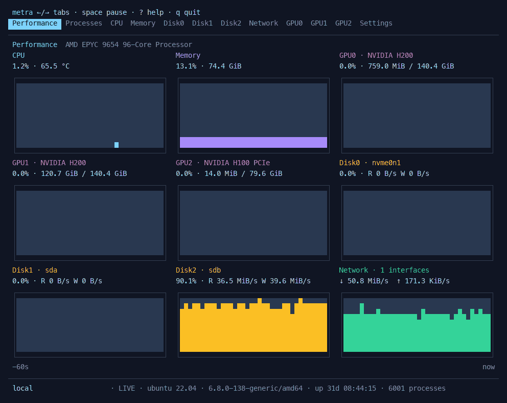
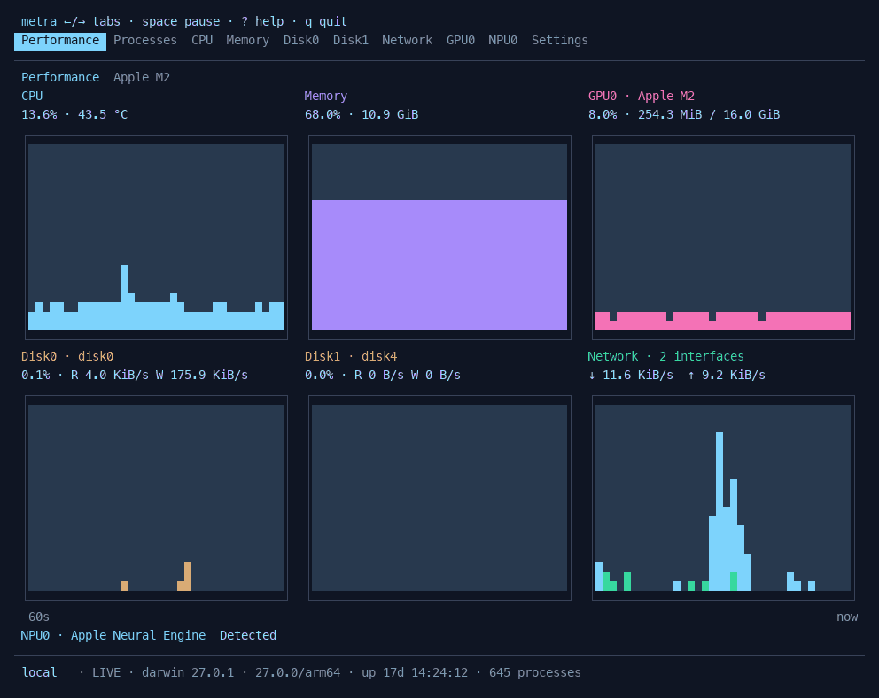

# Metra

[中文](README.zh-CN.md) · [Releases](https://github.com/raywcm/metra/releases)

Metra is a terminal system monitor for Linux and macOS. It puts hardware charts and processes in task-manager-style tabs, and works over SSH.

**Linux · NVIDIA H200 / H100**



**macOS · Apple M2**



Both demos use live system data. Host and user labels are hidden.

## Install

Download a binary from [Releases](https://github.com/raywcm/metra/releases), or use the installer:

```sh
curl -fsSLO https://github.com/raywcm/metra/releases/latest/download/install.sh
sh install.sh
export PATH="$HOME/.local/bin:$PATH"
metra
```

The installer checks SHA-256 and installs to `~/.local/bin`. Add that directory to your `PATH` if needed. Set `METRA_PREFIX` to change the destination or `METRA_VERSION` to select a release.

Homebrew:

```sh
brew tap raywcm/metra https://github.com/raywcm/metra
brew install raywcm/metra/metra
```

Linux packages are also available as `.deb`, `.rpm` and `.pkg.tar.zst`. There is no apt or yum repository.

Metra runs as a single executable; it does not need Go, Python or a background service. GPU and NPU metrics use the drivers and management interfaces already installed on the host. Builds are available for Linux and macOS, on amd64 and arm64.

## What it shows

- **Overview:** CPU, memory, disk, network and accelerator activity on one page.
- **Processes:** CPU and resident memory, search, process tree, details and termination with confirmation. The default order is CPU, then memory, then PID.
- **Hardware tabs:** larger history charts, memory composition, disk activity and throughput, and network traffic by interface.
- **Accelerators:** per-device memory and engine activity, with clocks, temperatures, power and PCIe / HBM bandwidth where the driver exposes them.

Charts use full and half block characters. As the terminal gets smaller, secondary charts give way to values; in very small windows, values remain scrollable. Large CPU counts use a compact per-core table. Grid lines are off by default.

Metra reads Linux affinity, cgroup and Slurm limits when available. It filters Snap mounts, pseudo filesystems and internal container interfaces, while keeping data volumes and active VPNs.

### Hardware support

| Hardware | Linux | macOS |
| --- | --- | --- |
| CPU, memory, disks, network, processes | Yes | Yes |
| NVIDIA GPU | `nvidia-smi`, optional NVML counters | — |
| AMD / Intel GPU | DRM sysfs, depending on driver | IOAccelerator, depending on driver |
| Apple GPU | — | IORegistry; shared memory, renderer and tiler activity |
| Ascend NPU | `npu-smi`; engine activity and HBM | — |
| Other NPUs | accel sysfs, depending on driver | Apple Neural Engine identification only |

Unavailable metrics are omitted. Device identification does not imply that utilization counters are readable. Accelerator utilization is the highest reported engine utilization, rather than a sum of engines. See [sampling and platform notes](docs/architecture.md) for the details.

## Keys

| Key | Action |
| --- | --- |
| `←` / `→`, `Tab` / `Shift+Tab` | Switch tabs |
| `↑` / `↓`, `j` / `k` | Select a row or scroll |
| `PgUp` / `PgDown`, `Home` / `End` | Move through longer views |
| `Space` | Pause or resume |
| `/` | Search processes |
| `s` / `r` | Change sort field / reverse order |
| `t` | Toggle process tree |
| `Enter` / `d` | Process details |
| `x` | End a process; `y` confirms, `Esc` cancels |
| `c` | Toggle per-core CPU view |
| `,` | Settings; arrows adjust, `Enter` saves, `Esc` cancels |
| `?` | Help |
| `q` / `Ctrl+C` | Quit |

Process CPU usage counts one logical core as 100%, so a process can exceed 100%. New processes need two samples before CPU usage is available. Termination sends SIGTERM using your current permissions; Metra does not elevate privileges or send SIGKILL.

## Settings

English and Simplified Chinese are built in. Language and light / dark theme follow the environment by default; both can be changed in Settings.

```sh
metra --language zh-CN --theme light
metra --interval 2s
metra --snapshot
metra --help
```

Settings are saved to `$XDG_CONFIG_HOME/metra/settings.json`, or the platform default: `~/.config/metra/settings.json` on Linux and `~/Library/Application Support/metra/settings.json` on macOS. Use `--config PATH` for a separate configuration.

## Build

Requires Go 1.26 or newer.

```sh
git clone https://github.com/raywcm/metra.git
cd metra
make build
./bin/metra
```

Built with [Bubble Tea](https://github.com/charmbracelet/bubbletea), [Bubbles](https://github.com/charmbracelet/bubbles), [Lip Gloss](https://github.com/charmbracelet/lipgloss) and [gopsutil](https://github.com/shirou/gopsutil).

For tests, terminal recording and release builds, see [CONTRIBUTING.md](CONTRIBUTING.md).

[MIT](LICENSE). Dependency licenses are listed in [THIRD_PARTY_NOTICES.md](THIRD_PARTY_NOTICES.md).
