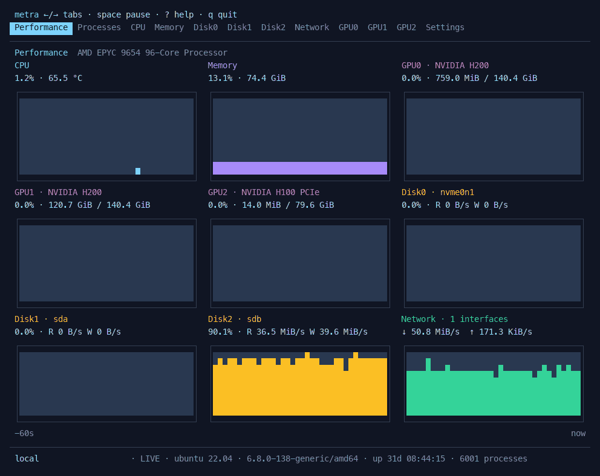
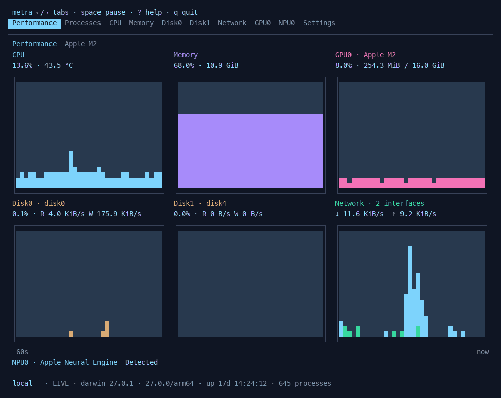

# Metra

[English](README.md) · [下载](https://github.com/raywcm/metra/releases)

Metra 是一个面向 Linux 和 macOS 的终端系统监控工具。用类似任务管理器的标签页查看硬件和进程，也可以通过 SSH 使用。

**Linux · NVIDIA H200 / H100**



**macOS · Apple M2**



两段演示均录自实际运行的程序，使用实时系统数据；主机和用户标签已隐藏。

## 安装

从 [Releases](https://github.com/raywcm/metra/releases) 下载对应平台的程序，或使用安装脚本：

```sh
curl -fsSLO https://github.com/raywcm/metra/releases/latest/download/install.sh
sh install.sh
export PATH="$HOME/.local/bin:$PATH"
metra
```

脚本校验 SHA-256，默认安装到 `~/.local/bin`。该目录需要在 `PATH` 中。`METRA_PREFIX` 可修改安装位置，`METRA_VERSION` 可指定版本。

Homebrew：

```sh
brew tap raywcm/metra https://github.com/raywcm/metra
brew install raywcm/metra/metra
```

Linux 同时提供 `.deb`、`.rpm` 和 `.pkg.tar.zst`，暂不提供 apt / yum 软件源。

运行时只需一个可执行文件，无需安装 Go、Python 或后台服务。GPU / NPU 指标使用主机已有的驱动和管理接口。发行包支持 Linux / macOS 的 amd64、arm64。

## 功能

- **总览**：在一页查看 CPU、内存、磁盘、网络和加速器。
- **进程**：CPU、常驻内存、搜索、进程树、详情，以及确认后结束进程。默认按 CPU、内存、PID 排序。
- **硬件页**：实时历史曲线、内存组成、磁盘活跃时间与读写速度、分网卡流量。
- **加速器**：各设备的内存与引擎使用率；驱动支持时显示频率、温度、功耗、PCIe 和 HBM 带宽。

图表使用深浅方块及半格字符。终端缩小时，次要图形逐步退为数值；极小窗口仍可滚动查看。大量 CPU 核心使用紧凑数值表。网格默认关闭。

Linux 上会读取可用的 CPU 亲和性、cgroup 和 Slurm 限制。默认过滤 Snap、伪文件系统和容器内部网卡，保留数据卷与实际使用的 VPN。

### 硬件支持

| 硬件 | Linux | macOS |
| --- | --- | --- |
| CPU、内存、磁盘、网络、进程 | 支持 | 支持 |
| NVIDIA GPU | `nvidia-smi`，可用时读取 NVML 扩展计数器 | — |
| AMD / Intel GPU | DRM sysfs，取决于驱动 | IOAccelerator，取决于驱动 |
| Apple GPU | — | IORegistry：共享内存、渲染器及平铺器使用率 |
| 昇腾 NPU | `npu-smi`：引擎使用率、HBM 等 | — |
| 其他 NPU | accel sysfs，取决于驱动 | Apple Neural Engine 仅识别设备 |

读不到的指标会省略。识别到设备不代表驱动提供了利用率。GPU / NPU 总体利用率取各引擎最大值，不累加。采样口径与平台差异见[架构说明](docs/architecture.md)。

## 操作

| 按键 | 操作 |
| --- | --- |
| `←` / `→`、`Tab` / `Shift+Tab` | 切换页面 |
| `↑` / `↓`、`j` / `k` | 选择或滚动 |
| `PgUp` / `PgDown`、`Home` / `End` | 翻页、跳转 |
| `Space` | 暂停 / 恢复 |
| `/` | 搜索进程 |
| `s` / `r` | 切换排序字段 / 反序 |
| `t` | 进程树 |
| `Enter` / `d` | 进程详情 |
| `x` | 请求结束进程；`y` 确认，`Esc` 取消 |
| `c` | CPU 每核心视图 |
| `,` | 设置；方向键调整，`Enter` 保存，`Esc` 取消 |
| `?` | 帮助 |
| `q` / `Ctrl+C` | 退出 |

进程 CPU 的 100% 表示一个逻辑核心，因此可能超过 100%。新进程需要两次采样才能计算 CPU。结束操作发送 SIGTERM，遵循当前用户权限，不提权、不发送 SIGKILL。

## 设置

内置中文和英文，默认跟随系统语言与终端明暗背景，也可在设置中指定。

```sh
metra --language zh-CN --theme light
metra --interval 2s
metra --snapshot
metra --help
```

配置优先保存在 `$XDG_CONFIG_HOME/metra/settings.json`。未设置时，Linux 使用 `~/.config/metra/settings.json`，macOS 使用 `~/Library/Application Support/metra/settings.json`。`--config PATH` 可指定其他文件。

## 从源码构建

需要 Go 1.26 或更新版本。

```sh
git clone https://github.com/raywcm/metra.git
cd metra
make build
./bin/metra
```

使用 Bubble Tea、Bubbles、Lip Gloss 和 gopsutil。测试、演示录制和打包方式见 [CONTRIBUTING.md](CONTRIBUTING.md)。

[MIT 许可证](LICENSE) · [第三方许可证](THIRD_PARTY_NOTICES.md)
